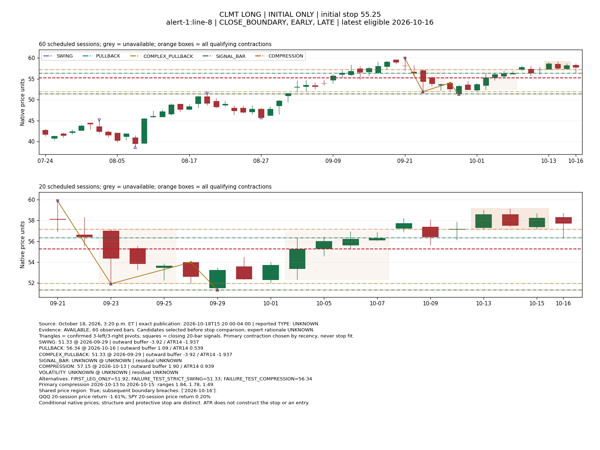
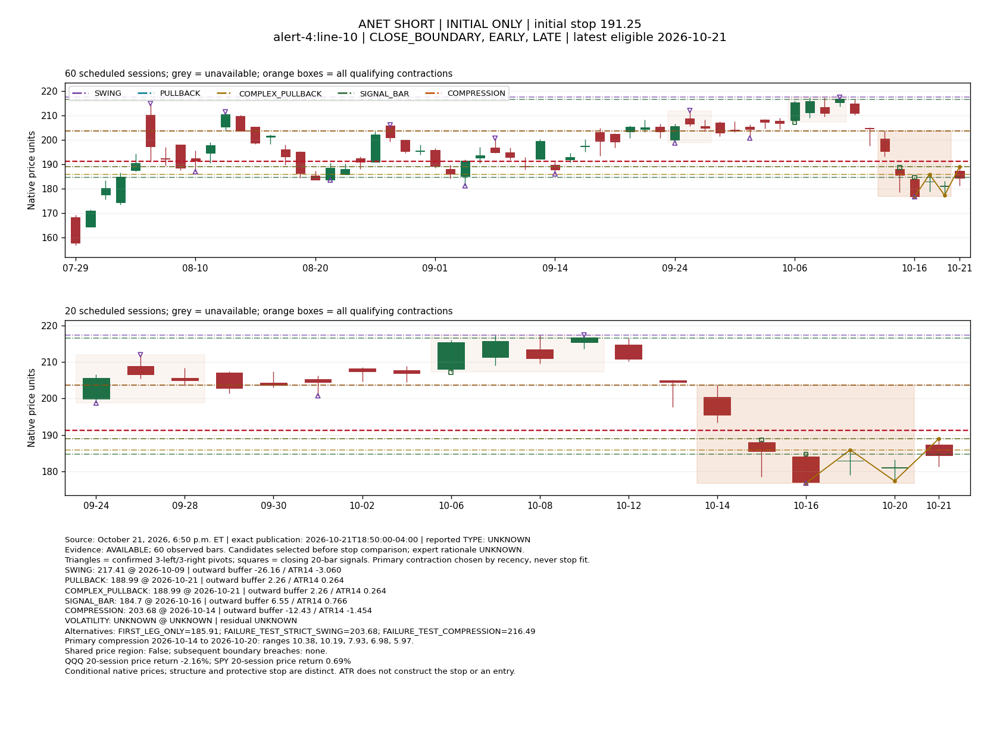
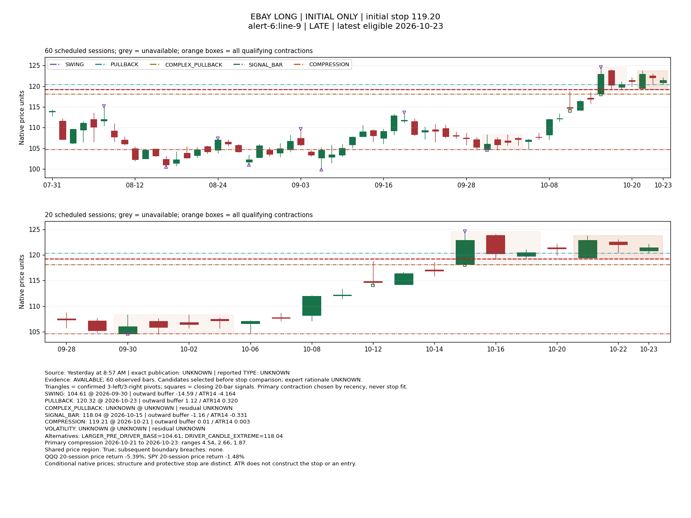

# PR9F — Initial Stop Inference from Grimes' Trading Patterns

Research question: **Which pre-decision trading patterns and invalidation levels plausibly explain each first published stop, and when does protection extend beyond the immediate structure?** This is retrospective abductive research using existing evidence. The [charter](../research/GRIMES_RESEARCH_ROADMAP.md) and [revised protocol](../research/PR9F_PATTERN_HYPOTHESES.md) govern attribution, causality and uncertainty.

**The reconciled population is 42 initial-stop decisions: 22 LONG and 20 SHORT.** The supplied 118-row log corroborates 28 openings already in PR9E and adds eight episodes to the original 34. Thirty-one episodes have usable pre-decision daily charts; eleven remain unavailable. Those eleven include all eight openings with explicit MarketLife TYPE labels. Consequently this study can investigate price-pattern explanations in the historical cohort, but cannot establish differences between the explicitly labelled Pullback, Tight pullback and Nested pullback groups.

The main insight is **scale and pattern relevance**, rather than a universal numerical buffer. CLMT's recent pullback and failed-test extreme offer a more relevant candidate than an older broad swing. ANET supplies an observed two-leg correction whose second extreme differs from its first. EBAY supports a local nested-pause interpretation conditional on the information clock, while an older support interpretation remains equally plausible. AMD illustrates a protective stop beyond the immediate rebound and near a wider contraction boundary. CNQ and SAIL preserve failures. None establishes Grimes' private rule or predictive accuracy.

## Evidence, recovery and source reconciliation

The interrupted implementation and its immutable 34/37-cohort snapshots are preserved at recovery commit `8566b723d41f857874739c944f4519965e88a2bf`. The older 37 count is a dated provisional result. New outputs use a separate version; PR9E and those draft artifacts were not rewritten. The inspected base is merged PR9E, `423d73ae2a7322f3dbc618dff27e95aca374194d`, on branch `research/grimes-initial-structural-stops-v1`.

The [dated log](../evidence/pr9f-expanded-source-20261103-v1/change-log-20261102.txt), [book excerpts](../evidence/pr9f-expanded-source-20261103-v1/book-excerpts.txt), and [provenance](../evidence/pr9f-expanded-source-20261103-v1/provenance.json) preserve the user-supplied text. The header and actual text both contain **118 changes**, October 20–November 2. That verifies the supplied capture's row count, not complete external MarketLife history. The [reconciliation](../evidence/pr9f-initial-patterns-v2/reconciliation.json) links every row to a captured episode; [source-events.csv](../evidence/pr9f-initial-patterns-v2/source-events.csv) retains each literal description and date.

| Supplied log action | Rows | Interpretation for this study |
| --- | ---: | --- |
| NEW SETUP | 36 | 28 overlapping openings and eight additional episodes |
| TRIGGERED | 15 | Reported entry-condition event; no extra opening or observed subscriber fill |
| STOP MOVED | 33 | Retained current-stop source fact; excluded from initial-stop hypotheses |
| STOPPED OUT | 5 | Source-tracked termination; no stop-out mechanics modeled |
| DROPPED / TAKEN OFF | 29 | Source removal, retaining original wording; no removal rationale modeled |

Six October 18 openings precede the visible log and remain in the original cohort. Hence `34 + (36 − 28) = 42`, rather than treating the 118 changes, 15 triggers or repeated timing scenarios as independent stop decisions. There are 40 distinct symbols; GME and SLB each have two observed episodes. No source row is unmatched. Detailed reconciliation and scope limitations are also in [the source report](GRIMES_INITIAL_STOP_SOURCE_RECONCILIATION.md).

The user's statement that publication was **5 p.m. November 2, 2026** is stored separately from historical row dates. We interpret the supplied hour in the session's America/New_York timezone, explicitly recording that timezone assumption and hour precision. The latest batch is bracketed from 17:00 through 17:59:59.999999 ET; this is not an invented exact timestamp. Earlier rows retain log dates with unknown intraday publication. The November 3 commentary/intended Tuesday session and the Monday November 2 log date are linked as sources about the same three openings, not counted twice. Original PR9E publication bounds and cutoffs remain unchanged, including the undated weekly alert.

SLB illustrates the distinction: the October 26 LONG opening has initial stop **51.10**; October 27 TRIGGERED carries **52.60**; November 2 reports that earlier episode stopped out and a fresh LONG Pullback setup at **51.90**. The new record is `SLB-002`, not another revision of `SLB-001`. Likewise, DUK's initial stop remains **122.90**, not its triggered/current 124.70/126.60; CRWV's remains **66.20**, not 58.80/55.00. These are factual episode links, not management-rule explanations.

## Theoretical foundation and what is observed

Grimes' [Fundamental Trading Patterns](https://www.adamhgrimes.com/fundamental-trading-patterns/) motivates the distinctions between trend corrections, failed resumptions, probes/reversals, reversal pullbacks and breakouts. The user-provided Chapter 3 excerpt describes a complex pullback's failed resumption and second countertrend leg. The Chapter 10 excerpt describes a small pause within a larger driving pattern, permits overlap with the first pullback after a breakout, and explains why a protective stop may leave room for volatility expansion. Its discussion of exiting on decisive pattern violation also distinguishes structural invalidation from mandatory holding to a stop. Figure captions/text were supplied; the figure images and full chapters were not.

[Patterns within patterns](https://www.adamhgrimes.com/patterns-within-patterns/) supplies additional primary context for the local/larger-pattern distinction. These teachings motivate our competing explanations; they do not attribute the repository's numerical detectors to Grimes. The book excerpts are user-provided evidence, not independently authenticated edition/page scans.

**Nested and complex are different axes.** A complex correction has an ordered failed resumption and further countertrend leg. A nested pullback is a small pause within an active larger pattern. They can coexist at different scales, but one is not a synonym for the other. MarketLife TYPE is a third, separately sourced classification. Tight pullback is not silently mapped to Complex pullback.

| Observed MarketLife TYPE | Episodes | Usable current charts | Source timing qualification |
| --- | ---: | ---: | --- |
| Pullback | 4 | 0 | Explicit NEW SETUP rows: AXGN, KSS, XOP, new SLB |
| Tight pullback | 2 | 0 | Explicit NEW SETUP rows: BA, NCLH |
| Nested pullback | 2 | 0 | Explicit NEW SETUP rows: AVGO, new GME |
| Breakout | 0 documented | 0 | Vocabulary reported; no episode-specific label supplied |
| UNKNOWN | 34 | 31 | Do not infer publisher TYPE from our price proxies or prose summaries |

The [setup-family register](../evidence/pr9f-initial-patterns-v2/setup-family-evidence.csv) distinguishes opening log date, the November 2 historical snapshot, source attribution and unverified original-alert applicability. A TYPE attached to a historical NEW SETUP row is retained as such; it is not independent proof of its original intraday publication. Later dashboard classifications are not backfilled. MRNA's earlier narrative description as a snap pullback remains prose evidence, not a fabricated dashboard TYPE.

## Causal reconstruction and competing candidates

The working policy is **pattern/context → structurally meaningful entry → protective stop → entry-to-stop ATR risk → decision filter**. Intended entry remains latent here. We do not invert a desired risk multiple to generate it.

The candidate stage receives admitted prices and direction, without stops, source TYPE, entry references or preferred risk bands. Its output is sealed before comparison with stops. Historical failures informed this protocol revision, so programmatic masking does not make the research blind, held out or prospectively validated. The local one-bar segmentation is a uniform hypothesis about scale, not a per-stop selected parameter. Existing broad baselines remain alongside it.

Stop-masked chart views are retained for [CLMT](grimes-initial-patterns-masked-v2/p001-CLMT-masked.svg), [ANET](grimes-initial-patterns-masked-v2/p014-ANET-masked.svg) and [EBAY](grimes-initial-patterns-masked-v2/p021-EBAY-masked.svg). They expose the price-only candidates without the published stop; the detailed comparisons below restore it. The masking is reproducible, not evidence of an independent blind review.

Every view uses up to 60 preceding scheduled daily bars. Cash Close plus 60 minutes must be **strictly before** the cutoff. Missing sessions are not filled or skipped; a missing latest required session makes the decision unavailable even when older bars exist. TEVA's contiguous 25-bar initial chart remains available with short-history status. Unknown publication dates retain EARLY, CLOSE_BOUNDARY and LATE views. They produce **64 distinct chart views for the same 42 decisions**, not 64 independent setups.

| Hypothesis | Candidate construction before seeing stop | Evidence against / latent issue | Discriminating observation |
| --- | --- | --- | --- |
| H1 Swing invalidation | Strict three-left/three-right confirmed swing baseline; separately retain latest one-bar local swing | Significance and chosen scale are unobserved. Confirmation must precede cutoff. | A future rationale distinguishing a local turn from the broad swing |
| H2 Simple pullback | Most recent local favorable pivot, confirmed by one right bar, then the opposing counterleg extreme; preserve old 20-bar baseline | Local extrema do not by themselves establish a trend or intended setup; latest need not mean most relevant. | A setup whose recent and older correction extremes differ materially |
| H3 Complex pullback | Ordered favorable/adverse/favorable pivots, failed resumption, then another adverse leg; retain first-leg and full-correction extremes | Sequences may be historical or already resolved; their relevance to the fresh setup needs chart review. No future successful resolution is assumed. | A source stop/rationale protecting the second leg rather than the first |
| H4 Breakout/failure structure | Signal candle versus prior-20 base; latest probe/reclaim of a pre-existing confirmed swing or established compression boundary | A tested/reclaimed boundary differs from an untouched one. A candle is not the whole base. | A case with separated test extreme, signal extreme and base boundary |
| H5 Nested/compression | Maximal runs of at least three strictly contracting High–Low ranges; local extreme, preceding driver candle and larger base kept separately | Compression alone does not prove nesting. Driver may be absent, stale or already tested; overlapping ranges can drift. | A timestamped local pause within a clearly documented larger driving pattern |
| H6 Volatility-derived alternative | Retain as UNKNOWN without an independent anchor/entry/multiplier | A free multiplier can fit any stop and cannot identify a policy. | An independently specified rule or explicit source explanation on another case |

Contraction intervals end within the last 20 available bars and retain their maximal observed extent. All detected intervals remain in [compression.csv](../evidence/pr9f-initial-patterns-v2/compression.csv); recency selects the primary. Common price overlap, prior-range comparison, age and pre-decision tests are recorded continuously. They are not optimized thresholds. A fixed ten-bar box remains only a descriptive baseline. The driver proxy reuses the existing recent closing-breakout inventory; failure to detect that proxy is not proof that no larger pattern exists.

For LONG, signed protective room is `boundary − published stop`; for SHORT it is `published stop − boundary`. Price distance, $0.01 research units and shared ATR14 normalization are recorded separately. The research unit is not a verified contract minimum tick. ATR14 comes from the pinned shared wheel through existing admission/features; no ATR mathematics or fitted stop formula was added.

The [hypothesis matrix](../evidence/pr9f-initial-patterns-v2/matrix.csv) contains **745 candidate/view records**. It distinguishes pattern evidence/status, proposed relevance, protective room, prior boundary tests/reclaims, contradictory observations, alternatives, latent assumptions and a discriminating observation. `weak_geometry` only means the stop is on/beyond a level protective relative to the available Close. Close is not an entry. A boundary tested and reclaimed before publication contradicts its **untouched-boundary version**, not every possible reclaim or deeper-protection thesis. Positive room does not establish anticipated volatility expansion. The internal larger-pattern flag means a preceding algorithmic driver candidate was found; companion driver-test/status fields qualify it, and expert intent remains UNKNOWN.

## Full-population descriptive results

| Primary LATE family proxy | Candidate available | Primary weak geometry | Any retained candidate geometry | Stop inside primary boundary | Median absolute primary residual / ATR |
| --- | ---: | ---: | ---: | ---: | ---: |
| COMPLEX_PULLBACK | 17 | 2 | 2 | 15 | 2.378 |
| COMPRESSION | 30 | 10 | 12 | 19 | 0.951 |
| PULLBACK | 31 | 29 | 29 | 2 | 0.320 |
| SIGNAL_BAR | 28 | 11 | 14 | 11 | 0.682 |
| SWING | 31 | 0 | 13 | 31 | 2.592 |
| VOLATILITY | 0 | 0 | 0 | 0 | UNKNOWN |

Each column counts decisions, not candidate rows. Families overlap. The median includes every available primary residual, including wrong-side boundaries. The broader alternative column is not a model-selection score.

| Stratum | Decisions | Usable LATE charts | Primary local-counterleg geometry |
| --- | ---: | ---: | ---: |
| direction: LONG | 22 | 16 | 14 |
| direction: SHORT | 20 | 15 | 15 |
| cohort: EXPANDED_LOG_NEW | 8 | 0 | 0 |
| cohort: PR9E_INITIAL_34 | 34 | 31 | 29 |
| marketlife_type: Nested pullback | 2 | 0 | 0 |
| marketlife_type: Pullback | 4 | 0 | 0 |
| marketlife_type: Tight pullback | 2 | 0 | 0 |
| marketlife_type: UNKNOWN | 34 | 31 | 29 |

The primary local-counterleg proxy has geometric correspondence in 29/31 usable charts; this does not identify 29 simple pullbacks. The two primary failures in LATE are CNQ and SAIL. Local scale was introduced after known baseline failures, and broader alternatives are retained, so these counts cannot establish predictive performance.

These are correspondence counts, not numbers of explained stops. Multiple candidates increase opportunities for accidental correspondence. No residual tolerance, closest-level winner, parameter search, posterior probability or predictive accuracy is reported. Source TYPE is known for eight episodes, while usable price evidence belongs to the other cohort: this missing joint coverage prevents a defensible empirical TYPE comparison.

The complete captured population, with one row per opening (original publication evidence remains in the linked inventory):

| Episode | Direction | First stop | Opening date evidence | TYPE | LATE market evidence |
| --- | --- | ---: | --- | --- | --- |
| AAPL-001 | LONG | 339.00 | 2026-10-18 (alert) | UNKNOWN | Usable |
| CLMT-001 | LONG | 55.25 | 2026-10-18 (alert) | UNKNOWN | Usable |
| TEVA-001 | LONG | 40.40 | 2026-10-18 (alert) | UNKNOWN | Usable; short history |
| CAT-001 | SHORT | 748.75 | 2026-10-18 (alert) | UNKNOWN | Usable |
| CDE-001 | SHORT | 16.40 | 2026-10-18 (alert) | UNKNOWN | Usable |
| T-001 | SHORT | 24.00 | 2026-10-18 (alert) | UNKNOWN | Usable |
| ELF-001 | LONG | 110.50 | 2026-10-20 (log) | UNKNOWN | Usable |
| HUM-001 | LONG | 404.00 | 2026-10-20 (log) | UNKNOWN | Usable |
| SIG-001 | LONG | 111.80 | 2026-10-20 (log) | UNKNOWN | Usable |
| ASST-001 | SHORT | 28.45 | 2026-10-20 (log) | UNKNOWN | Usable |
| OMER-001 | SHORT | 17.20 | 2026-10-20 (log) | UNKNOWN | Usable |
| GME-001 | LONG | 25.01 | 2026-10-21 (log) | UNKNOWN | Usable |
| AAOI-001 | SHORT | 89.82 | 2026-10-21 (log) | UNKNOWN | Usable |
| AMD-001 | SHORT | 569.90 | 2026-10-21 (log) | UNKNOWN | Usable |
| ANET-001 | SHORT | 191.25 | 2026-10-21 (log) | UNKNOWN | Usable |
| SNDK-001 | SHORT | 1458.00 | 2026-10-21 (log) | UNKNOWN | Usable |
| ABBV-001 | LONG | 276.30 | 2026-10-23 (log) | UNKNOWN | Usable |
| CNQ-001 | LONG | 53.30 | 2026-10-23 (log) | UNKNOWN | Usable |
| EBAY-001 | LONG | 119.20 | 2026-10-23 (log) | UNKNOWN | Usable |
| GTLB-001 | LONG | 51.60 | 2026-10-23 (log) | UNKNOWN | Usable |
| MMM-001 | LONG | 169.90 | 2026-10-23 (log) | UNKNOWN | Usable |
| SNOW-001 | SHORT | 330.70 | 2026-10-23 (log) | UNKNOWN | Usable |
| SAIL-001 | LONG | 20.90 | 2026-10-26 (log) | UNKNOWN | Usable |
| SLB-001 | LONG | 51.10 | 2026-10-26 (log) | UNKNOWN | Usable |
| GE-001 | SHORT | 295.80 | 2026-10-26 (log) | UNKNOWN | Usable |
| SCCO-001 | SHORT | 191.70 | 2026-10-26 (log) | UNKNOWN | Usable |
| PLTR-001 | LONG | 187.40 | 2026-10-27 (log) | UNKNOWN | No market evidence |
| MRNA-001 | SHORT | 214.30 | 2026-10-27 (log) | UNKNOWN | No market evidence |
| DUK-001 | LONG | 122.90 | 2026-10-28 (log) | UNKNOWN | Usable |
| PAA-001 | LONG | 26.00 | 2026-10-28 (log) | UNKNOWN | Usable |
| DECK-001 | SHORT | 82.90 | 2026-10-28 (log) | UNKNOWN | No market evidence |
| FCX-001 | SHORT | 67.50 | 2026-10-28 (log) | UNKNOWN | Usable |
| CRWV-001 | SHORT | 66.20 | 2026-10-29 (log) | UNKNOWN | Usable |
| NBIS-001 | SHORT | 185.80 | 2026-10-29 (log) | UNKNOWN | Usable |
| AXGN-001 | LONG | 47.30 | 2026-10-30 (log) | Pullback | No market evidence |
| BA-001 | SHORT | 177.30 | 2026-10-30 (log) | Tight pullback | No market evidence |
| KSS-001 | LONG | 22.80 | 2026-10-30 (log) | Pullback | No market evidence |
| NCLH-001 | LONG | 17.01 | 2026-10-30 (log) | Tight pullback | No market evidence |
| XOP-001 | LONG | 194.90 | 2026-10-30 (log) | Pullback | No market evidence |
| AVGO-001 | SHORT | 335.40 | 2026-11-02 (log) | Nested pullback | No market evidence |
| GME-002 | SHORT | 24.90 | 2026-11-02 (log) | Nested pullback | Missing required sessions |
| SLB-002 | LONG | 51.90 | 2026-11-02 (log) | Pullback | Missing required sessions |

## Detailed initial-stop cases

The [case-selection register](../evidence/pr9f-case-selection-v2/selection.json) was frozen after the entire inventory/matrix was produced. Selection is retrospective and seeks mechanistic contrast and failures. All other decisions remain in the inventory and matrix.

### CLMT — a local pullback or failed test, with room beyond the boundary

**Observed source decision:** LONG initial stop 55.25, October 18; last admitted bar October 16. No later stop enters this case.

**Pre-decision structure:** October 14's 59.16 high is locally confirmed October 15. The subsequent correction reaches 56.34 on October 16 and closes 57.75. Ranges contract 1.84→1.78→1.49 during October 13–15, with local floor 57.15; October 16 probes below that floor and closes back above it. The earlier broad swing and full older correction lie around 51.33.

**Competing explanations:** H2 protects the local 56.34 counterleg extreme. H4 protects the same failed-test extreme. Both put the stop 1.09 below that boundary, or **0.539 ATR**. H5's original 57.15 floor gives 1.90 / 0.939 ATR of room, but its untouched-floor version has already failed. H1/H3's broad 51.33 level lies below the stop and does not explain full-pattern protection.

**Assessment:** local correction/reclaim invalidation is plausible; the shared 56.34 level makes H2 and H4 observationally equivalent on these bars. The 1.09 room could accommodate noise, another timeframe or a discretionary buffer. Its purpose is not identified by ATR distance. A stale broad structure is a counterexample to equating the latest detected older complex sequence with the active setup.

**Latent variables and test:** intended entry, relevant scale and invalidation convention. Another supplied case with a pullback low separated from a failed-test extreme would distinguish the explanations; do not retune the local scale to this stop.

[Annotated chart](grimes-initial-patterns-v2/p001-CLMT.svg)



### ANET — the second countertrend leg matters

**Observed:** SHORT initial stop 191.25, October 21; information includes that session's completed bar.

**Structure:** a strong decline reaches 176.77 on October 16. A rally reaches 185.91 on October 19; the attempt to resume downward reaches only 177.36 on October 20, above the previous low. The next adverse leg reaches 188.99 on October 21. This ordered failed resumption and second rally is a defensible complex-correction hypothesis, distinct from simply identifying contracting ranges.

**Comparison:** first-leg invalidation is 185.91, while the full observed correction extreme is 188.99. The published stop is 5.34 above the first and **2.26 / 0.264 ATR** above the second. The simple latest-counterleg interpretation shares 188.99. The broad confirmed high 217.41 and contraction high 203.68 lie beyond the stop and contradict those broader-boundary versions. The contraction also lacks a common price region.

**Assessment:** local/full-correction resistance with additional protective room is more plausible than whole-broad-swing protection. H2 and H3 still share the same final extreme; the stop alone cannot reveal whether Grimes emphasized the second leg or simply the latest rally. MarketLife TYPE remains UNKNOWN; this is not a silent mapping to Tight or Nested pullback.

**Test:** a source rationale or another initial stop between the first- and second-leg boundaries would discriminate. No later price outcome is used to establish that the correction eventually succeeded.

[Annotated chart](grimes-initial-patterns-v2/p014-ANET.svg)



### EBAY — nested context is plausible, but timing and an older level compete

**Observed:** LONG initial stop 119.20 in the original weekly alert. Its exact publication remains UNKNOWN; the new log labels the opening October 23.

**Structure:** October 15 closes above the prior range, with signal low 118.04. The October 21–23 pause has contracting ranges 4.54→2.66→1.87, overlapping prices and local floor 119.21. The October 16 pullback low is 119.20. The fresh local counterleg floor at the LATE cutoff is 120.32, and the broader pre-driver base floor is 104.61.

**Comparison:** the stop is **0.01 / 0.00285 ATR** below the local contraction floor, exactly at the older 119.20 pullback low, and 1.12 / 0.320 ATR below the freshest local counterleg. It sits inside the driver-candle and larger-base invalidation levels. This favors local protection over protecting the entire breakout base, without identifying which local rationale was used.

**Timing counterexample:** the three-bar October 21–23 contraction is not available in EARLY/CLOSE_BOUNDARY, which end October 22. Their most recent completed contraction is October 15–19 with floor 118.04, below the published stop. LATE permits the newer nested-pause hypothesis. The count labelled October 23 does not authorize inserting Friday's completed prices into an earlier assumed publication.

**Assessment and test:** the local pause within an intact preceding breakout is consistent with the supplied nested-pullback teaching. The older horizontal low is an equally simple explanation, and near-equality is vulnerable to price-basis/precision uncertainty. Source TYPE remains UNKNOWN. A precisely timed case separating the historical support and local contraction boundary would discriminate. One research tick of room here does not support a universal deeper-stop rule.

[EARLY](grimes-initial-patterns-v2/p020-EBAY.svg) · [LATE](grimes-initial-patterns-v2/p021-EBAY.svg)



### AMD — deeper than the freshest rebound, near a wider pause boundary

**Observed:** SHORT initial stop 569.90, October 21.

**Structure:** the chart declines from the October 6 high 658.52 into lower prices. October 15–19 ranges contract 38.53→24.13→18.74; that interval's high is 568.62. The freshest rebound reaches only 556.79 on October 21. Both structures are observable; the fixed preceding-driver test does not identify a qualifying prior closing breakout before this contraction, so the algorithm does not establish nesting.

**Comparison:** stop 569.90 leaves **13.11 / 0.474 ATR** beyond the freshest rebound, but only **1.28 / 0.046 ATR** beyond the wider contraction high. The larger swing/old complex high 658.52 lies above the stop. The older signal high 550.96 has already been exceeded and is below the current Close.

**Assessment:** protecting the wider pause can explain why the stop is deeper than the immediate rebound. A discretionary volatility allowance beyond the freshest rebound is another interpretation. The small residual at 568.62 cannot distinguish them. Mean contraction range is about 1.224 times the prior-ten mean, so contracting from a large range is not synonymous with an unusually quiet regime. The source TYPE is UNKNOWN; visual continuation context is not a verified publisher Nested label.

**Test:** another predeclared case where the local rebound, wider pause and larger driver are separated, ideally with a source explanation. The risk preference cannot be inverted to manufacture AMD's missing entry.

[Annotated chart](grimes-initial-patterns-v2/p013-AMD.svg)

### Counterexamples and unresolved cases retained

- **CNQ initial 53.30:** in LATE the local counterleg low is 53.08, so the stop is **0.22 / 0.157 ATR inside** it. The older 53.38 signal low offers a different geometric explanation but was already tested. This challenges a universal local-extreme rule; reclaim, another scale and buffer convention remain latent. [EARLY](grimes-initial-patterns-v2/p018-CNQ.svg), [LATE](grimes-initial-patterns-v2/p019-CNQ.svg).
- **SAIL initial 20.90:** local low 18.44, broad low 18.32 and available compression boundaries all lie below the stop; the fixed breakout detector has no qualifying signal. A small unobserved structure or another thesis could matter, but this dictionary does not explain it. Keep UNKNOWN rather than change the interval or buffer. [Chart](grimes-initial-patterns-v2/p028-SAIL.svg).
- **T initial SHORT 24.00:** the 23.85 local high gives 0.15 / 0.230 ATR room. The same high bounds contracting ranges, but their common price intersection is empty and the driver was tested. Geometric equality does not establish consolidation or nesting. [Chart](grimes-initial-patterns-v2/p005-T.svg).
- **HUM initial 404.00:** pullback low and local contraction floor both equal 407.50, giving 3.50 / 0.170 ATR room. They are competing descriptions of shared evidence, not independent confirmations. The proposed older driver was already tested; do not promote compression to an intact nested pattern. [Chart](grimes-initial-patterns-v2/p007-HUM.svg).
- **CDE initial SHORT 16.40:** the local opposing high 16.07 gives 0.33 / 0.427 ATR room, while broad high 17.495 is beyond the stop. This is consistent with local rather than whole-swing protection, with source TYPE and intended entry UNKNOWN. [Chart](grimes-initial-patterns-v2/p004-CDE.svg).
- **AAOI and SCCO:** their initial signal and local-counterleg levels offer alternative scales; neither positive distance establishes the chosen rationale. Their contraction/broad boundaries provide counterevidence to a universal compression stop. [AAOI](grimes-initial-patterns-v2/p012-AAOI.svg), [SCCO](grimes-initial-patterns-v2/p031-SCCO.svg).

## New observed families and the evidence limit

The five October 30 additions are AXGN LONG 47.30, BA SHORT 177.30, KSS LONG 22.80, NCLH LONG 17.01 and XOP LONG 194.90. November 2 adds AVGO SHORT 335.40, GME SHORT 24.90 and SLB LONG 51.90. Their original NEW SETUP records establish the initial stops; subsequent source changes do not replace them.

The existing archive has no AVGO/AXGN/BA/KSS/NCLH/XOP price evidence. New GME and SLB retain older bars but miss the required current sessions. At the LATE November 2 cutoff, GME lacks October 27–30 and November 2; SLB lacks October 30 and November 2. Their earlier views also lack required sessions. They are unavailable in every scenario. These are not failed structural hypotheses and do not justify using their earlier episodes' chart as a current reconstruction.

For **AVGO and GME**, the observed Nested label motivates comparing a local pause with its larger drive and protective room; the available data cannot identify those levels. For **new SLB**, explicit prior termination plus NEW SETUP establishes a separate episode, but does not explain the new 51.90 level from the old 52.60 tracked outcome. The remaining newly labelled Pullback/Tight cases have the same market-evidence limitation. No acquisition or completeness initiative was started.

[AVGO UNKNOWN](grimes-initial-patterns-v2/p059-AVGO.svg) · [GME missing sessions](grimes-initial-patterns-v2/p061-GME.svg) · [SLB missing sessions](grimes-initial-patterns-v2/p063-SLB.svg)

## Entry-to-Stop Risk as a Decision Filter

The [new guidance](../evidence/pr9f-risk-guidance-20261103-v1/guidance.json) records the user's report of Grimes' **preferred 0.8–1.4 ATR entry-to-stop risk** and concern above approximately **2 ATR**. These are attributed preferences, not independently verified quotations or hard rules. The descriptive bands are below 0.8, 0.8–1.4 inclusive, above 1.4 through 2 inclusive, and above 2. They never determine an entry, stop, buffer or winning structural hypothesis.

Entry is selected from pattern, price structure and confirmation; the protective stop reflects invalidation and expected behavior. Then `abs(entry − stop) / ATR14` evaluates the risk, with the stop on the protective side. ATR must be appropriate to the observed entry decision, not automatically the initial publication date. A stop-to-**boundary** residual in this report is not entry risk.

The 15 TRIGGERED log rows report conditions/attached stops, but supply no entry prices. The two later November 2 dashboard excerpts contain AHE references: DUK 125.12 and CRWV 56.12. Neither reference was observed at its initial setup decision, and its exact entry time/price-basis compatibility is unverified. There are **zero fully timed valid entry-risk observations**, so a distribution across preferred-risk bands cannot be estimated. All 42 initial-decision risk records remain UNKNOWN rather than failed tests. No entry predictor is implemented.

| Later reported AHE reference | First published stop | Reference-to-first-stop distance | Conditional prior ATR session | Conditional ATR14 | Conditional ratio / band |
| --- | ---: | ---: | --- | ---: | --- |
| DUK LONG 125.12 | 122.90 | 2.22 | Oct 28, if entry occurred during reported Oct 29 trigger session | 2.049286 | 1.083; 0.8–1.4 |
| CRWV SHORT 56.12 | 66.20 | 10.08 | Oct 29, if entry occurred during reported Oct 30 trigger session | 6.517143 | 1.547; above 1.4 through 2 |

These two **conditional** calculations use only the prior completed daily ATR, not an entry-day bar known afterward. They are retrospective reference-to-first-stop geometry, not verified actual initial risk or evidence that triggered trades tend to satisfy the preference. The protective stop associated with a later entry may also differ from the first published stop; this PR does not model that management decision. The machine [risk context](../evidence/pr9f-initial-patterns-v2/risk-context.json) marks both observed risk bands UNKNOWN and keeps conditional bands separately named.

DUK's later current stop 126.60 and CRWV's 55.00 do not overwrite their initial stops. LAST 128.38/50.15 is never substituted for entry. No literal published TO STOP values were supplied, so that field remains unobserved; the dashboard's latest-price/current-stop distance would in any case be a different quantity. Decision-time ATR by publication scenario, initial stops, cutoff and provenance remain in [inventory.csv](../evidence/pr9f-initial-patterns-v2/inventory.csv); later references and timing assumptions remain in the separate risk context.

The next milestone is **structural entry-trigger inference**: explain observable TRIGGERED conditions, then assess independently selected entry/stop risk by pattern and context. Test whether excessive risk corresponds to waiting/removal only with suitable source and timing evidence. Do not generate an entry from the preferred band or infer reasons for removal in PR9F.

## Interpretation, reproducibility and limits

The strongest explanations are local and case-specific; multiple families often share a level. Seventeen LATE charts have a schematic complex-sequence candidate, but some sequences are older or already resolved and do not define the fresh setup. Thirty primary contraction candidates do not mean thirty nested setups. Internal pattern-status labels identify fixed proxies, not Grimes' taxonomy. A broad pivot, a ten-bar box, a first-leg extreme and a local pause can all be observable while only some are relevant to the actual trade thesis.

These results use the existing conditional native split-adjusted IBKR archive, inherited unknown corporate-action/stop comparability and later capture vintages. The parent export is `3794e40ad67aef9a136c7647e278308ecf90089e55b1b75288de12d826e5cc41`, ultimately based on native archive `07882253d2207a3117a115d40e04f469b207eccfd99f8b67a0375377e4ec5184`. October 30 capture does not prove identical historical dissemination. The earlier known vintage conflicts are retained, not silently repaired. Scientific conclusions concern those frozen inputs, not certified raw execution prices.

The revised hypotheses were developed with knowledge of historical cases. Additional candidate scales increase chance correspondence. No pattern fit, positive buffer or conditional risk preference is evidence of a trading edge. A future supplied case with separated local/larger boundaries, a timestamp and explanatory source statement would discriminate more strongly than another favorable residual in this retrospective sample.

The unchanged draft method remains replayable; the revised method is selected explicitly:

```bash
export PYTHONPATH=src
P=runs/grimes-initial-patterns-20261103-v2
.venv/bin/python scripts/grimes_initial_stops.py --help
.venv/bin/python scripts/grimes_initial_stops.py --method patterns_v3 prepare \
  --parent runs/grimes-structural-stops-20261030-v1/inputs-v1 \
  --parent-sha256 3794e40ad67aef9a136c7647e278308ecf90089e55b1b75288de12d826e5cc41 \
  --observation docs/evidence/pr9f-expanded-source-20261103-v1 \
  --earlier-observation docs/evidence/pr9f-operator-source-20261103-v1 \
  --risk-guidance docs/evidence/pr9f-risk-guidance-20261103-v1 --output NEW_INPUT_DIRECTORY
# Read market.json's exact SHA-256 from that directory's hashes.json:
.venv/bin/python scripts/grimes_initial_stops.py --method patterns_v3 annotate \
  --market NEW_INPUT_DIRECTORY/market.json --market-sha256 MARKET_FILE_SHA256 --output NEW_ANNOTATION_DIRECTORY
.venv/bin/python scripts/grimes_initial_stops.py --method patterns_v3 compare \
  --annotations NEW_ANNOTATION_DIRECTORY --source NEW_INPUT_DIRECTORY/source.json --output NEW_STUDY_DIRECTORY
.venv/bin/python scripts/grimes_initial_stops.py --method patterns_v3 replay \
  --study "$P/study-v1" --output NEW_REPLAY_DIRECTORY
.venv/bin/python scripts/grimes_initial_stops.py --method patterns_v3 charts \
  --study "$P/study-v1" --selection docs/evidence/pr9f-case-selection-v2/selection.json --output NEW_CHART_DIRECTORY
.venv/bin/python -m pytest -q
```

Use exclusive new directories; no command overwrites a frozen run. Add `--original-cohort-only` when preparing the original 34 comparison. Full native reproduction needs the existing local archive; no provider access is required. Committed projections contain one [primary observation per initial decision](../evidence/pr9f-initial-patterns-v2/initial-observations.csv), the complete matrix and annotations without native bar rows. Test fixtures are offline and do not establish an expert policy or an edge.

Validation completed November 5, 2026: **807 passed in 218.24s (0:03:38)** using the complete offline `python -m pytest -q` suite. The [validation packet](../evidence/pr9f-validation-v2/validation.json) records source/test hashes and the [exact test output](../evidence/pr9f-validation-v2/pytest-final.log). Tests cover source reconciliation, separate repeated episodes, causal cutoffs, future-price poisoning, complex versus nested candidates, risk-band boundaries, missing observations, altered semantic outputs and deterministic replay.

The [preservation audit](../evidence/pr9f-validation-v2/preservation.json) rehashed **71,731 pre-existing files: zero changed and zero missing**. All 22 checked PR9F/public chart/native stage bundles verified. [Cohort checks](../evidence/pr9f-validation-v2/cohort-reconciliation.json) confirm that the original 34 source identities, stops, publication evidence and cutoffs are unchanged; their admitted price windows are unchanged; their revised-method matrix is identical inside the full and original-only studies. Native semantic replay reproduces the 42-episode study, original-34 study and preserved 37-episode draft byte for byte. No execution simulator, production forecast gate or acquisition code changed.

| Immutable output | SHA-256 bundle hash |
| --- | --- |
| Expanded supplied-source capture | `f73a9b9cc5ec148fc44944460452b36aeb4937b0e2a0c359a7c1d77bc476cb7a` |
| Full native study / replay | `f618d909e18f7d910e3436c0aa006e699c8cbbe2772b147a828e4982d26e772c` |
| Original-34 revised study / replay | `89e731af37ca337524ee553afc99592794fbf6b25408528ad7d15e72ae279b39` |
| Full public projection | `675b42be6b5e06d1941b90924fe34587e339d6ac8482ac863128d485a8ecfbd9` |
| Original-34 public projection | `bfc8bf354b1d5b30e1feb7e1172ee145393a3d668fef8b371174cfb48aa5d4e2` |
| Selected annotated charts | `17bf05256e57ea4dbc89294e6864735fbf311f33d7e79d4962e8e7a4ee0d04cb` |
| Selected stop-masked charts | `d269cb4717dea6119da0ee1ee6e6bb3720ccbf2b44a595991dc1f4d3dfca9daa` |
| Validation packet | `ebb4f5806f2b134c084bb4c153cc3c3143050f348c5510d839c1d688fca0f8df` |

The committed projections and charts support review without brokerage access; full native replay additionally requires the existing local frozen price archive. Unavailable decisions and the missing entry observations remain UNKNOWN, rather than numerical failures or grounds for an expanded acquisition project. Subsequent stop-revision explanations and structural entry-trigger inference remain separate future studies.
