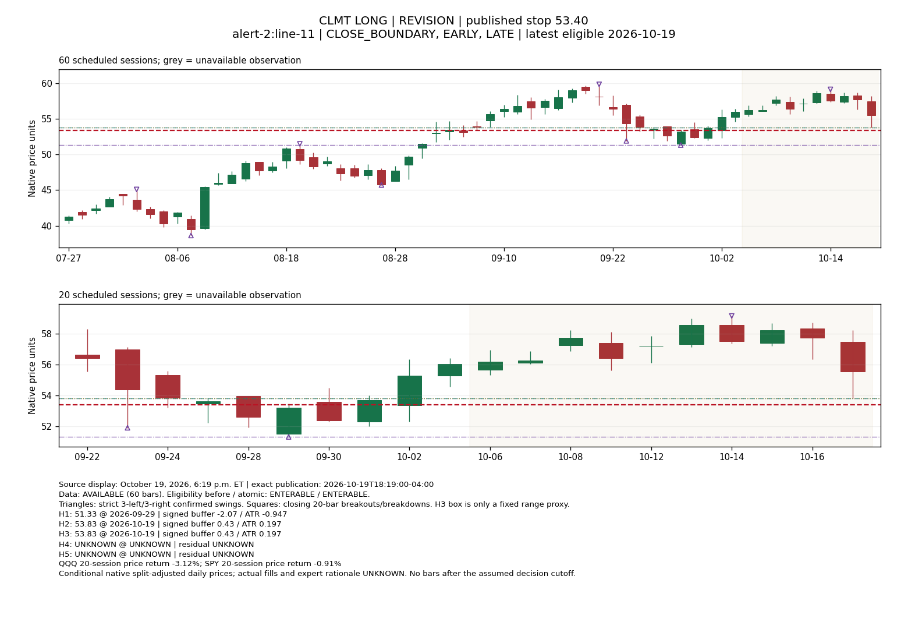

# PR9E — Full-population structural stop inference

Scientific question: **Which observable structural mechanisms plausibly explain the full captured set of MarketLife initial stops and revisions?** This is retrospective abductive inference under the [research charter](../research/GRIMES_RESEARCH_ROADMAP.md), not stop prediction, parameter optimization or an execution study.

The study includes **34 episodes and 77 distinct stop decisions: 34 initial stops and 43 revisions**, from ten captured alert clusters covering October 18–29, 2026. The originally suggested six names are illustrations, not a filter. The inventory was completed before selecting detailed cases. It does not represent all MarketLife history or a historical screening universe. Original PLTR/PEP drops have no captured opening stop and do not supply additional stop decisions; the subsequently ADDED PLTR episode is included.

**Finding:** recent pullback extremes provide a plausible explanation for several LONG initial stops and revisions, particularly CLMT, TEVA and EBAY. They do not explain the entire population. The latest confirmed three-bar swing and fixed ten-bar boundary are generally farther away than the published stop. Signal-bar explanations sometimes remain plausible, but many candidate signals have already been breached. Some revisions tighten protection inside every tested boundary; others widen a stop without changing the candidate anchor. Timing changes the interpretation of CDE and SAIL. These observations favor competing, potentially setup-dependent mechanisms over a universal rule. They do **not** identify Grimes' private method or an investment edge.

## Evidence and population

- [Full decision inventory](../evidence/pr9e-structural-stops-v1/inventory.csv): one row per source event, retaining stop, old stop, verbatim source decision, source hash, publication evidence, eligibility and all conditional clocks.
- [Candidate/residual matrix](../evidence/pr9e-structural-stops-v1/matrix.csv): **565 rows = 113 unique chart views × five families**, including UNKNOWN/unavailable records.
- [Revision comparison](../evidence/pr9e-structural-stops-v1/revision-comparisons.csv): 43 revisions × three clocks × five families, comparing old/new anchors and stops. These 645 rows are sensitivity records, not 645 observations.
- [All masked chart annotations, without native bars](../evidence/pr9e-structural-stops-v1/annotations-without-bars.json), [descriptive aggregates](../evidence/pr9e-structural-stops-v1/summary.json), [protocol](../evidence/pr9e-structural-stops-v1/protocol.json), [source ledger inputs](../evidence/pr9e-structural-stops-v1/source.json), and [immutable lineage](../evidence/pr9e-structural-stops-v1/lineage.json).
- [Case-selection register](../evidence/pr9e-case-selection-v1/selection.json): 25 views from eleven names selected for mechanistic contrast, ambiguity, timing and counterexamples after inspecting the full inventory. Selection is retrospective, not random or held out.

There are 17 LONG and 17 SHORT openings; repeated revisions produce 45 LONG and 32 SHORT decisions. Six revisions occur while already UNDERWAY. Fourteen revisions are co-published with an ENTERABLE→UNDERWAY transition. The atomic assessment, not textual line ordering, determines whether a fresh opportunity exists. SAIL's October 29 revision occurs while previously UNDERWAY, alongside an explicit return to ENTERABLE. These are setup decisions: no personal position, actual fill, realized risk or order modification is inferred.

All market evidence comes from the existing qualified-contract IBKR daily archive, SHA-256 `07882253d2207a3117a115d40e04f469b207eccfd99f8b67a0375377e4ec5184`. It was semantically replayed against its native capture proofs before export. No broker connection, vendor fetch, new source intake or completeness project occurred. Historical prices are the retained conditional native split-adjusted TRADES basis, not verified raw execution prices; source-stop comparability and corporate-action completeness remain uncertain. Capture on October 30 does not prove the same price vintage was disseminated at each historical decision.

## Procedure fixed before the numerical comparison

The stop-masked annotation stage receives only qualified market evidence, symbol, direction and conditional cutoff. It cannot receive a published stop. Its immutable output is sealed before the comparison stage joins source stops. This prevents programmatic nearest-stop selection; the analyst already knew these historical cases, so this is **not genuinely blind research**.

[Masked CLMT display](grimes-structural-stops-masked-v1/v007-CLMT-masked.svg), [TEVA](grimes-structural-stops-masked-v1/v022-TEVA-masked.svg), [EBAY](grimes-structural-stops-masked-v1/v040-EBAY-masked.svg) and [HUM](grimes-structural-stops-masked-v1/v026-HUM-masked.svg) make the annotation comparison inspectable. These illustrative displays were rendered after the study; the separate sealed annotation stage establishes the programmatic ordering, not a claim of analyst blinding.

Each view uses at most 60 scheduled daily bars strictly available before its cutoff, under the inherited cash-close-plus-60-minute availability assumption. A pivot requires three subsequent completed bars. No later bar or later pivot confirmation enters an earlier view. A missing required session makes that view unavailable; it is not skipped or filled. A contiguous history of 20–59 bars remains usable but short. TEVA has 25–29 bars at its three decisions; SMA50 and longer structures remain unknown. The three instruments with no market evidence (PLTR, MRNA and DECK) retain all four stop decisions as UNKNOWN.

EARLY, CLOSE_BOUNDARY and LATE are inherited conditional publication scenarios, not invented source timestamps. The weekly alert's exact publication remains **UNKNOWN**. October 27–29 alerts have only a supplied date. Thirty-six decisions have two distinct chart views, giving 113 total. Every scenario still has exactly 77 decisions. LATE is the declared primary descriptive view; it is not asserted to be the actual publication time or selected to improve fit.

| Family | Fixed observable proxy | Supporting evidence sought / limitation |
| --- | --- | --- |
| H1 — swing | Latest strict three-left/three-right directional LOW for LONG or HIGH for SHORT, within available 60 bars | Stop on/beyond a confirmed protective pivot. Recency is a reproducible proxy for significance, not proof of significance. Other pivots are annotated, not searched for minimum residual. |
| H2 — pullback | Latest favorable extreme in 20 bars, followed by at least two bars and an adverse Close move; opposing extreme since that origin | Stop on/beyond a provisional retracement extreme. This need not be a confirmed pivot and does not validate the setup's quality or trend. |
| H3 — consolidation | Opposing boundary of the fixed last ten bars; path efficiency recorded continuously | A range boundary is observable, but a ten-bar box is **not proof of consolidation**. It never earns an identified-explanation verdict merely through proximity. |
| H4 — signal bar | Opposite extreme of the latest directional Close beyond the previous 20-bar high/low, searched in the last 20 available bars | Protects an observable breakout/breakdown bar. Prior breaches are recorded; a stale or reclaimed signal needs a different invalidation story. Many discretionary signal bars need not meet this definition. |
| H5 — volatility | No manufactured stop or fitted multiplier | Entry, volatility reference and multiplier are unobserved. Close-to-stop/ATR is only reference geometry. H5 remains unidentified, not disproven. |

These numerical definitions are repository research hypotheses, **not rules attributed to Grimes**. Their constants were not swept, optimized or adjusted after examining residuals. The broader hypotheses survive failure of a narrow proxy: a stop inside the latest strict pivot does not prove that no smaller, unconfirmed, older or intraday structure matters. No source setup family is asserted. BREAKOUT_PROXY/PULLBACK_PROXY strata are descriptive price classifications, partly defined by candidate availability, not independent validation of intended setup families.

Signed outward distance is `level − stop` for LONG and `stop − level` for SHORT. Positive means beyond the boundary; zero means exactly at it; negative means inside it. Matrix distances include native price units, **$0.01 research units** and inherited ATR14 price units. The $0.01 unit is not a verified qualified-contract minimum tick; fractional research ticks can occur in adjusted prices. ATR14 comes through the pinned shared mathematics wheel, with the existing 15-observation interface. No ATR formula, stop multiplier or fitted buffer is introduced.

“Geometrically compatible” requires a stop on/beyond the candidate and the candidate protective relative to the latest Close. It does not impose a good-fit tolerance, infer an entry, or establish a causal explanation. Even a large outward residual can satisfy this weak test. H3 remains RANGE_PROXY_ONLY; H5 UNKNOWN. Medians below summarize absolute residuals **over all available candidates**, including wrong-side failures, rather than a cherry-picked matching subset.

## Full-population descriptive results

| Publication scenario | Usable (including short history) | No market evidence | Missing required session | One geometric proxy | Multiple | No compatible proxy |
| --- | ---: | ---: | ---: | ---: | ---: | ---: |
| CLOSE_BOUNDARY | 71 | 4 | 2 | 36 | 8 | 27 |
| EARLY | 71 | 4 | 2 | 36 | 8 | 27 |
| LATE | 66 | 4 | 7 | 38 | 7 | 21 |

LATE, 77 decisions throughout; family counts overlap:

| Family | Candidate available | Weak geometric compatibility | Stop inside boundary | Not protective to Close | UNKNOWN | Median absolute residual / ATR |
| --- | ---: | ---: | ---: | ---: | ---: | ---: |
| H1 | 66 | 0 | 66 | 0 | 11 | 2.814 |
| H2 | 39 | 32 | 7 | 0 | 38 | 0.268 |
| H3 | 66 | 0 | 60 | 0 | 11 | 1.959 |
| H4 | 58 | 20 | 28 | 10 | 19 | 0.636 |
| H5 | 0 | 0 | 0 | 0 | 77 | UNKNOWN |

H3’s 66 available candidates all remain RANGE_PROXY_ONLY (six BEYOND, 60 INSIDE), not successful explanations. H1/H2/H4 wrong-side and UNKNOWN counts partition the remaining records.

| LATE stratum | Decisions | Usable charts | H1 compatible | H2 compatible | H4 compatible |
| --- | ---: | ---: | ---: | ---: | ---: |
| direction: LONG | 45 | 40 | 0 | 21 | 11 |
| direction: SHORT | 32 | 26 | 0 | 11 | 9 |
| decision_type: INITIAL | 34 | 31 | 0 | 19 | 11 |
| decision_type: REVISION | 43 | 35 | 0 | 13 | 9 |
| revision_role: ENTERABLE_REVISION | 37 | 29 | 0 | 13 | 6 |
| revision_role: MONITORED_UNDERWAY | 6 | 6 | 0 | 0 | 3 |
| observable_family_proxy: PULLBACK_PROXY | 39 | 39 | 0 | 32 | 9 |
| observable_family_proxy: BREAKOUT_PROXY | 12 | 12 | 0 | 0 | 3 |
| observable_family_proxy: UNKNOWN | 26 | 15 | 0 | 0 | 8 |

ENTERABLE/UNDERWAY **before** the decision: 71/6 decisions; their usable LATE charts are 60/6 and H2-compatible counts 32/0. The 37 ENTERABLE revisions above include the 14 co-published UNDERWAY transitions, which do not create an intervening entry opportunity. Expert setup-family labels remain UNKNOWN for all 77.

One supplied alert narrative specifically calls MRNA a “snap pullback short.” Preserve that **operator-supplied narrative context**, rather than turning the price proxies into Grimes' intended setup taxonomy. It identifies the opening episode's described family, not necessarily the rationale for its next revision. Neither MRNA decision has market evidence, so that named-family subgroup cannot support a structural comparison:

| Source-narrative episode context | Initial decisions | Revisions | Usable LATE charts |
| --- | ---: | ---: | ---: |
| MRNA: snap pullback short, described in October 27 supplied narrative | 1 | 1 | 0 |
| No symbol-specific setup family named in captured narratives | 33 | 42 | 66 |

The complete wording and provenance remain in [source.json](../evidence/pr9e-structural-stops-v1/source.json), alert `operator-20261027`. This supplied summary is not an independently verified statement of expert intent. Index/futures patterns mentioned in the alert summaries are not assigned to individual stock episodes.

There are **14 already-breached anchors among the 20 geometrically compatible H4 decisions** in LATE. Only six pass both the weak geometry check and absence of an intervening breach of that candidate anchor. A signal could have been reclaimed or the actual thesis could use another boundary, but an untouched signal-bar explanation cannot simply be presumed. H2 is provisional and often includes the current bar, so it faces a different confirmation burden from H1. These families' counts are not calibrated competing model likelihoods.

H2 provides the broadest *geometric* compatibility here (32/77 decisions, 32/39 available H2 candidates), with overlap between families. It does not explain 32 decisions conclusively. Of the 66 usable LATE views, 38 have one compatible geometric proxy, seven have multiple, and 21 have none. Eleven more are unavailable. **All 77 retain unidentified expert intent**, including the 38 single-proxy cases. A sole survivor of an incomplete candidate dictionary is not an identified mechanism.

Among 35 revisions with both old and new charts usable in LATE, the selected H1 anchor changes in three, H2 in 16, H3 in 19 and H4 in 13. H2 changes include becoming available/unavailable, not just newly confirmed structure. All 35 change the published stop by definition; anchor changes do not account for every revision. The eight other revisions lack a usable new chart. These are dependent decisions across ten source clusters, with no significance tests, calibrated probabilities or statistical independence claim.

The unavailable LATE decisions are PLTR's opening, MRNA's opening/revision and DECK's opening; October 27 ABBV/GTLB/HUM/GE/OMER revisions; and October 28 GTLB/GE revisions. EARLY/CLOSE_BOUNDARY have 71 usable decisions and six unavailable; some October 27 decisions can then use October 26 prices. This conditional availability does not authorize using stale prices in the corresponding LATE views.

## Detailed cases selected from the completed inventory

### CLMT — new pullback extreme explains a revision better than a confirmed pivot

1. **Observed:** initial 55.25 on October 18; 53.40 on October 19; 53.02 on October 20. All three assessments remain ENTERABLE. Source times admit October 16, 19 and 20 respectively.
2. **Structure:** the October 19 bar reaches 53.83 and closes 55.54 after the prior upswing. The selected confirmed LOW remains September 29's 51.33. The October 19 low is provisional at the revision, not a three-right-bar-confirmed pivot.
3. **Competing explanations:** H2 gives an invalidation boundary at 53.83; H3 happens to share that boundary. H1 requires a materially lower stop. H4 has no qualifying signal. H5 remains possible but unconstrained.
4. **For/against:** 53.40 is 0.43 (43 research ticks; 0.197 ATR) below 53.83. This is a plausible pullback-buffer explanation, with no fitted buffer. But the next stop, 53.02, widens the buffer to 0.81 (81 units; 0.374 ATR) **without a new low or new selected pivot**. The initial 55.25 lies inside all three available fixed structural candidates; the revision's explanation cannot be back-projected to explain the initial.
5. **Most plausible:** provisional pullback invalidation for October 19; October 20 also admits discretionary buffer/opportunity reassessment. The full sequence is not a fixed-buffer or confirmed-pivot rule.
6. **Latent:** intended entry, smaller-scale signal, acceptable buffer, expected reward and source-stop price basis.
7. **Discriminating test:** another revision with an unchanged pullback extreme separates a pure “new pivot → new stop” mechanism from a changed buffer or risk assessment. TEVA supplies that counterexample in this same packet; it is supporting retrospective evidence, not a held-out test.

[Initial chart](grimes-structural-stops-v1/v001-CLMT.svg) · [October 19](grimes-structural-stops-v1/v007-CLMT.svg) · [October 20](grimes-structural-stops-v1/v016-CLMT.svg)



### TEVA — two pullback anchors, then a changed buffer

1. **Observed:** 40.40 initial; 39.35 on October 21; 39.05 on October 22, while ENTERABLE.
2. **Structure:** H2 initially uses October 12's 40.60 low; October 21 creates a new 39.50 retracement low. October 22's low is 39.58, so the H2 boundary remains 39.50. H1 remains October 8's 38.25. Only 25–29 daily bars are available; the earlier chart is explicitly unknown.
3. **Competing explanations:** recent pullback boundary versus the deeper confirmed swing, a ten-bar box and unobserved volatility/discretionary buffer.
4. **For/against:** initial buffer is 0.20 / 0.177 ATR; October 21 buffer is 0.15 / 0.139 ATR; October 22 buffer grows to 0.45 / 0.409 ATR. The first two have defensible observable anchors. The last revision supplies no new H2 extreme; H3 now shares the same low, providing a competing range description rather than independent evidence. No defined H4 signal exists.
5. **Most plausible:** local retracement invalidation for initial/October 21, with an unexplained widening on October 22. This is stronger than a universal confirmed-swing account but incomplete.
6. **Latent:** structure before available history, intraday alternatives, buffer rationale and execution participation.
7. **Discriminating test:** if a subsequent similar revision changes the buffer while no new price extreme forms, the fixed-buffer version weakens further. A future supplied chart or explanatory alert could distinguish entry-opportunity reassessment from protection of an existing execution; this study does not presume either.

[Initial](grimes-structural-stops-v1/v002-TEVA.svg) · [October 21](grimes-structural-stops-v1/v022-TEVA.svg) · [October 22](grimes-structural-stops-v1/v027-TEVA.svg)

### EBAY — exact initial boundary, then two competing structures

1. **Observed:** initial 119.20 in the weekly alert, publication UNKNOWN; revision to 117.50 on October 26 while ENTERABLE. A modeled stop-out from earlier work is not a source fact and is not imported into this study.
2. **Structure:** October 16's low 119.20 bounds the pullback after the October 15 breakout. It is observable in both weekly timing views. October 26 reaches 117.87 and closes 118.62. The old breakout-bar low is 118.04; the confirmed swing proxy is much lower at 104.61.
3. **Competing explanations:** H2 retracement boundary; H4 protection/reclaim of the earlier breakout; H3 range boundary; H5 unknown.
4. **For/against:** initial stop equals the H2 boundary exactly in both timing views. This is a strong descriptive correspondence but also contradicts a claim that every stop includes a strictly positive buffer. Revised 117.50 lies 0.37 / 0.103 ATR below the new pullback low and 0.54 / 0.150 ATR below the breakout-bar low. **That breakout-bar low was already breached on October 26**, so H4 requires a reclaim/alternative-thesis interpretation. The wider ten-bar and confirmed-swing boundaries do not explain the tight placement.
5. **Most plausible:** H2 is a parsimonious explanation of the initial and revised levels; H4 remains a competing reclaimed-breakout explanation of the revision. Proximity alone does not distinguish them.
6. **Latent:** exact weekly publication, intended entry/timeframe, reclaim criterion, adjusted-price compatibility and private rationale.
7. **Discriminating test:** a case in which pullback and breakout-bar boundaries diverge materially, followed by an explicit stop rationale, would distinguish the anchors. GME below is a useful counterexample to treating every current pullback extreme as protected.

[Weekly EARLY](grimes-structural-stops-v1/v039-EBAY.svg) · [weekly LATE](grimes-structural-stops-v1/v040-EBAY.svg) · [revision](grimes-structural-stops-v1/v063-EBAY.svg)

### CDE — SHORT continuation, with a material publication-clock counterexample

1. **Observed:** 16.40 initial, 16.24 revision, then 14.30 co-published with UNDERWAY on October 22, and monitored 13.90 in the undated weekly alert. UNDERWAY is entry ineligibility, not proof of a short position.
2. **Structure:** the October 22 closing breakdown has high 14.51; October 23 has a further closing breakdown with high 13.765. The latest confirmed HIGH is far above, at 17.495. The full matrix retains the initial/revision alternatives as well as the detailed transition views.
3. **Competing explanations:** latest signal-bar invalidation; smaller intraday continuation structure; a tighter discretionary trailing mechanism; H5 or UNKNOWN.
4. **For/against:** 14.30 is **0.21 inside** the October 22 signal-bar high, so H4's full-bar invalidation fails. Weekly 13.90 is 0.61 inside 14.51 under EARLY/CLOSE_BOUNDARY. Under LATE it is 0.135 (13.5 research units; 0.169 ATR) above October 23's 13.765 high: geometrically plausible. Earlier H4 candidates also have intervening breaches. This is a clock-sensitive explanation, not a verified daily-high rule.
5. **Most plausible:** a continuation/recent-bar mechanism is plausible for the weekly revision **conditional on October 23 availability**. The October 22 transition remains a counterexample to full-signal-bar protection. A smaller unobserved structure or changed thesis may explain it; neither is established.
6. **Latent:** weekly publication, smaller timeframe, precise invalidation convention, whether any execution was managed.
7. **Discriminating test:** a timestamped future SHORT revision where the full signal-bar high and a smaller continuation boundary are separated would distinguish them. Do not use October 23 to explain a decision assumed to precede its availability.

[October 22](grimes-structural-stops-v1/v033-CDE.svg) · [weekly EARLY](grimes-structural-stops-v1/v057-CDE.svg) · [weekly LATE](grimes-structural-stops-v1/v058-CDE.svg)

### GME — the latest pullback-low rule has a direct failure

1. **Observed:** 25.01 initial, 24.78 revision on October 22, then weekly 24.40; ENTERABLE throughout these assessments.
2. **Structure:** initial H2 is October 20's 25.30; October 22 creates a 24.61 low. The old breakout-bar low is 25.77 and confirmed swing is 24.04.
3. **Competing explanations:** current pullback invalidation, an intraday/closing or older structure, and a different discretionary buffer.
4. **For/against:** initial 25.01 is 0.29 below the candidate pullback low. But 24.78 is **0.17 / 0.137 ATR inside** the newly available 24.61 low. The old signal boundary is also above the current Close. Weekly 24.40 moves 0.21 / 0.170 ATR below the same 24.61 low in LATE; the EARLY view retains that low too. A new source level cannot retroactively explain the previous inside-boundary stop.
5. **Most plausible:** H2 fits initial/weekly geometry but does not explain October 22. UNKNOWN or a different, unobserved structure is the defensible outcome for that revision.
6. **Latent:** intraday decision chart, intended entry, selected structural scale and stop convention.
7. **Discriminating test:** an explicitly timestamped source explanation distinguishing daily-low invalidation from an intraday or closing structure. Neither daily OHLC order nor a revised stop establishes an actual fill.

[October 22 counterexample](grimes-structural-stops-v1/v025-GME.svg) · [weekly LATE](grimes-structural-stops-v1/v050-GME.svg)

### SAIL — continuation and renewed opportunity, with an unexplained opening

1. **Observed:** 20.90 initial October 26; 21.30 with UNDERWAY October 27; 21.40 while UNDERWAY October 28; 20.70 with explicit return to ENTERABLE October 29. Daily publication times are unknown for the final three alerts.
2. **Structure:** October 16 confirmed low 18.32 remains far below all stops. The October 27 closing breakout has low 21.57. On October 29 price reaches 20.90 and closes 22.00, breaching and reclaiming 21.57.
3. **Competing explanations:** recent continuation/signal-bar protection, smaller pauses absent from the fixed proxy, renewed opportunity after a deeper pullback, or unknown discretionary/volatility construction.
4. **For/against:** no fixed candidate explains opening 20.90. The October 27 revision has no H4 signal in EARLY but a 21.57 signal low in LATE, with 0.27 / 0.250 ATR outward buffer. October 28's 21.40 also lies below 21.57. October 29's 20.70 is 0.87 / 0.780 ATR below that anchor in LATE, **after the anchor was breached**. The contemporaneous day low 20.90 is only available in LATE, and it is not a confirmed pivot or selected H2 pullback under the fixed definition. A post-comparison observation that 20.70 lies 0.20 below it is exploratory; it is not promoted to a new fitted candidate in the matrix.
5. **Most plausible:** conditional continuation protection for October 27–28; renewed opportunity after a deeper retracement is plausible for October 29. Neither explains the opening stop, and EARLY cannot invoke the later intraday low. The study does not mistake the monitored October 28 revision for renewed eligibility.
6. **Latent:** date-only publication, intraday structure, desired entry/reward and actual participation.
7. **Discriminating test:** another explicit UNDERWAY→ENTERABLE event with a timestamp that separates a new pullback extreme from the prior continuation boundary. Freeze that distinction before inspecting the future stop.

[Opening](grimes-structural-stops-v1/v059-SAIL.svg) · [October 27 EARLY](grimes-structural-stops-v1/v075-SAIL.svg) · [LATE](grimes-structural-stops-v1/v076-SAIL.svg) · [October 29 EARLY](grimes-structural-stops-v1/v103-SAIL.svg) · [LATE](grimes-structural-stops-v1/v104-SAIL.svg)

### Counterexamples outside the original six

**HUM, October 22:** observed 404.00→408.10 while ENTERABLE. October 19's 407.50 low has just become a confirmed three-right-bar pivot on October 22. H1/H2/H3 all refer to that level, yet the stop is **0.60 inside** it (−0.029 ATR). The newly confirmed pivot plausibly motivates the *timing* of tightening but fails an exact “beyond the pivot” account of placement. H4's older level is above the Close. Most plausible conclusion: structural association with unidentified buffer/scale, not a validated rule. Latent variables are smaller structure and invalidation convention. Test a later newly confirmed pivot with the stop clearly on one side of it, rather than relaxing the sign criterion to rescue this near miss. [Chart](grimes-structural-stops-v1/v026-HUM.svg).

**AAOI, October 22:** observed 89.82→70.70 with UNDERWAY. The sharp breakdown's high is 73.15, so stop 70.70 lies **2.45 inside** it (−0.261 ATR); H2 has no retracement and H1/H3 are much farther above. Continuation, an intraday boundary or volatility protection are possible but unidentified. This and CDE form a co-published SHORT continuation counterexample cluster: do not count their shared market day as independent proof of a rule. A timestamped smaller-timeframe signal or explicit rationale would discriminate; UNDERWAY itself does not identify the anchor or a resting stop order. [Chart](grimes-structural-stops-v1/v030-AAOI.svg).

**DUK, October 29:** observed 122.90→124.70 with UNDERWAY. EARLY's pullback low 123.45 is inside the published stop; LATE has a new breakout-bar low 124.58 but 124.70 remains 0.12 inside that boundary. A tightened intraday/close-based continuation stop is possible; a full daily signal-bar rule is contradicted in both views for different reasons. Date-only timing and unobserved structural scale remain latent. A future precisely timed analogous revision could distinguish them. [EARLY](grimes-structural-stops-v1/v105-DUK.svg) · [LATE](grimes-structural-stops-v1/v106-DUK.svg).

**PAA, October 29:** observed 26.00→26.66 with UNDERWAY. LATE's selected confirmed low 23.43, ten-bar low 25.05 and signal low 25.97 all lie below the published LONG stop; H2 is unavailable. A recent/smaller-scale continuation mechanism might matter, but none of the tested fixed proxies explains the stop. Keep UNKNOWN. A source chart showing the selected small-scale invalidation would discriminate; widening the lookback search after seeing 26.66 would not. [Chart](grimes-structural-stops-v1/v110-PAA.svg).

These cases were selected after full-population measurement. They show why the original six are not an adequate selection filter. The retained matrix also contains every unillustrated case and unavailable decision.

## Market context and revisions in the evidence itself

The annotation packet records SPY/QQQ returns and moving-average location at every assumed cutoff, independently of stop matching. For October 16, SPY/QQQ 20-session price returns are +0.20%/−1.61%; by October 22 they are −0.42%/−4.94%, with both below SMA50. This is observable market softness, not an inferred reason for an individual stop. At October 26 the returns are −0.03%/−3.30%. QQQ history ends October 26: October 27–29 views mark that context unavailable rather than carrying its last value forward. SPY remains available. No regime classifier is fitted.

The parent retains six conflicting October 26 vendor vintages. Five affect volume only (CNQ, MMM, SAIL, SLB, SPY); SIG High changes 118.85→118.86. A separately sealed [materiality replay](../evidence/pr9e-vintage-materiality-v1/materiality.json) substitutes only those existing captured alternatives in a **derived** view. It changes no structural anchor, boundary relation or verdict. Only SIG's October 29 ATR/residual normalization changes: LATE ATR 4.335000→4.335714; H2 residual −0.788927→−0.788797 ATR. EARLY/CLOSE_BOUNDARY ATR changes 4.187143→4.187857. Fifteen family/scenario records change numerically (one decision × three scenarios × five families), not fifteen independent decisions. The five volume differences cannot affect these price-only anchors or ATR; no volume-based conclusion is drawn. Retained prices, original artifacts and production forecast blockers remain unchanged.

## What this experiment can and cannot identify

It establishes concrete observable correspondences and falsifies **narrow proxy versions**: e.g. universal protection beyond the most recent strict confirmed swing, a fixed ten-bar boundary, or every full signal-bar extreme. It identifies promising provisional pullback explanations and revisions that need a changed buffer or different structural scale. It retains clock-sensitive explanations and substantial failures.

It cannot establish the intended setup family, chosen timeframe, entry, buffer, resting-order convention, private rationale or a universal stop formula. H5 is too unconstrained to distinguish with stops alone. Short-history views, source selection, dependent alerts, adjusted-price compatibility and later vendor vintages limit interpretation. No residual threshold, winning lookback, posterior probability, inferred personal position, performance estimate or trading edge is claimed.

Next discriminating experiment: freeze the competing *new pullback extreme*, *new confirmed pivot*, *signal-bar protection* and *unchanged-anchor/buffer reassessment* explanations before another supplied alert; specify the structural level and expected direction of revision using only then-available bars. A contrary revision should weaken the hypothesis rather than trigger a new lookback search. This is a scientific next test, not a new ingestion requirement or a bypass of existing prospective forecast gates.

## Reproduction and validation

Run from the repository root with the existing environment (`market-shared==0.2.0`; matplotlib 3.10.8 for rendering). No new data dependencies are installed. Native evidence remains local under `runs/`; reviewers without that archive can inspect the committed full inventory, residuals, source ledger, chart annotations and selected figures, and run synthetic boundary tests. Those fixtures validate computation, not expert behavior or an edge.

```bash
export PYTHONPATH=src
P=runs/grimes-structural-stops-20261030-v1
.venv/bin/python scripts/grimes_structural_stops.py --help
# Use NEW output directories on every rerun; existing bundles are exclusive.
.venv/bin/python scripts/grimes_structural_stops.py prepare \
  --archive runs/marketlife-current-20261030-live-v1/archive-v1 --output "$P/inputs-v1"
# Read market.json's SHA-256 from inputs-v1/hashes.json; pass that exact value:
.venv/bin/python scripts/grimes_structural_stops.py annotate \
  --market "$P/inputs-v1/market.json" --market-sha256 MARKET_FILE_SHA256 --output "$P/annotations-v1"
.venv/bin/python scripts/grimes_structural_stops.py compare \
  --annotations "$P/annotations-v1" --source "$P/inputs-v1/source.json" --output "$P/study-v1"
.venv/bin/python scripts/grimes_structural_stops.py replay \
  --study "$P/study-v1" --output "$P/replay-v1"
.venv/bin/python scripts/grimes_structural_stops.py charts \
  --study "$P/study-v1" --output "$P/charts-v1"
# Optional --masked and --selection docs/evidence/pr9e-case-selection-v1/selection.json.
.venv/bin/python scripts/grimes_structural_stops.py materiality \
  --study "$P/study-v1" --vintages "$P/inputs-v1/vintages.json" --output "$P/materiality-v1"
.venv/bin/python scripts/grimes_structural_stops.py evidence \
  --study "$P/study-v1" --inputs "$P/inputs-v1" --output NEW_REVIEW_PACKET_DIRECTORY
.venv/bin/python -m pytest -q
```

Study loading recomputes masked annotations, reconstructs the complete source inventory, verifies source/market decision identities and clocks, recomputes residuals/aggregates/revision comparisons and compares every derived byte. Resealing a modified output with valid file hashes does not make it semantically valid. This replay validates exported frozen inputs and computations; it does not newly establish original historical dissemination or source completeness.

Full offline regression: **767 passed in 126.76s (0:02:06)**, including 14 new structural-study tests. Tests cover source inventory/atomic eligibility, stop masking, future-bar poison, causal pivot confirmation, gaps, short history, signed residuals, semantic tamper rejection, immutable replay, vintage sensitivity, deterministic rendering and the full 77-decision committed population.

Study replay produced the identical bundle hash. Preservation verification checked **71,385 pre-existing files**, with zero changed or missing. Only new experiment code, evidence and figures plus the living roadmap are proposed; execution simulations, acquisition code and production forecast gates are unchanged. [Exact validation/log](../evidence/pr9e-validation-v1/validation.json) records code hashes and preservation evidence.

Branch: `research/grimes-structural-stops-v1`; inspected base/main commit: `5163b5ec0d66b28cebf9d6e60e4c92d599301ddb`.

| Immutable stage | Bundle SHA-256 |
| --- | --- |
| inputs | `3794e40ad67aef9a136c7647e278308ecf90089e55b1b75288de12d826e5cc41` |
| annotations | `39cc82db408e1cf63616ec446ee494801a416172aad66b96b7a034f1e85cf332` |
| study | `3c172cd44fc9ffec5ee6287eac6208c9bd6412c0082b5afe9425cf511869f24d` |
| replay | `3c172cd44fc9ffec5ee6287eac6208c9bd6412c0082b5afe9425cf511869f24d` |
| full_charts | `4a0c29bd83e373e48495b17d4517792de2deead5fcc450b1d1cf6d8de1ed7ec8` |
| materiality | `e3f576bd40f713f001247007fdb641b71e0a2b6d28e4dfc416e7f553519fbfa0` |
| review_packet | `bd5fc0bf0df903c324eeac397c49815b2210a058828738637cd144bc5640ac03` |
| selected_charts | `0df5cc1dd3b7d4b3d7f6471a1c02acda7a7d410af9b964bfed73a0379676f8e9` |
| masked_charts | `2b53a7ed9e233d97961e245e41556b56d24c5f84c9ed936f882d706c88146330` |

All 113 chart views are rendered locally (SVG and PNG). The committed selection contains 25 views from eleven names, plus four masked displays; the full candidate population remains in the committed matrices and annotations. Byte-identical rendering requires the pinned renderer/font environment recorded in chart manifests. Preserve existing directories and use new immutable versions if interpretation/code changes.
